# Desktop Rug · فرش دسکتاپ

A Persian rug that lives on your desktop, so you can sweep messy desktop files under it.
Cross-platform (Windows 10/11 + Linux) remake of Terkel Gjervig's ([@terkelg](https://x.com/terkelg)) macOS concept.

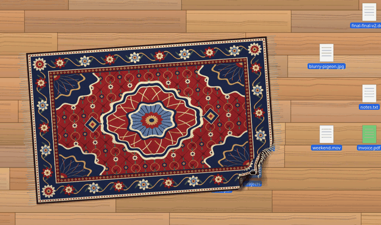

*Demo (AppImage on X11, recorded live): full corner fold by dragging, click to lay flat, fold from the left edge, click to unfold.*

| Corner folded over | Icons dragged into the gap | Laid flat, icons hidden | Folded from an edge |
|---|---|---|---|
| 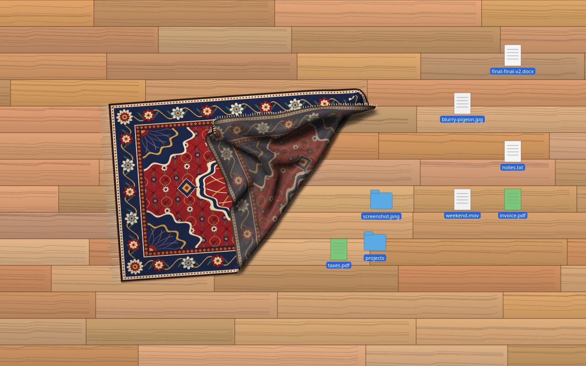 | 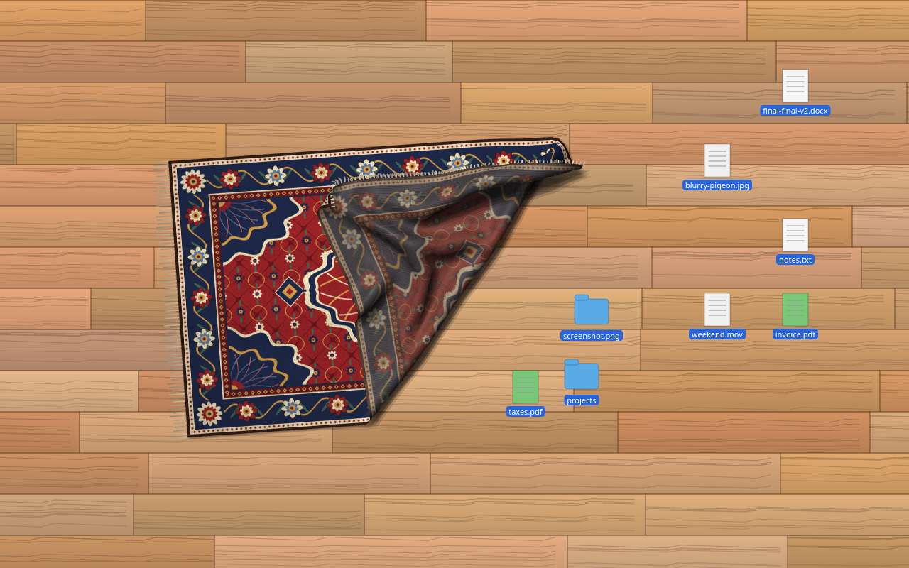 | 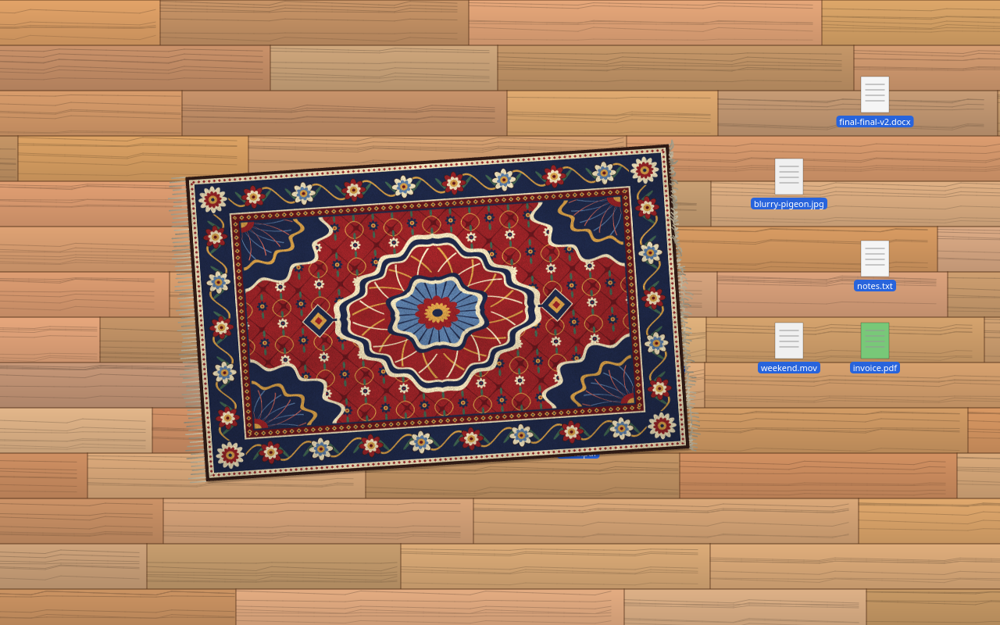 | 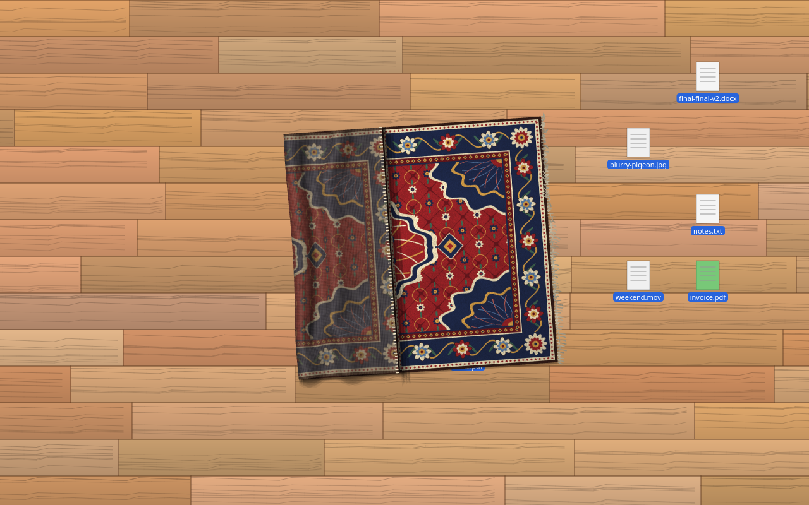 |

| Fold right over (off-screen render) | Folded twice | Edge fold |
|---|---|---|
| 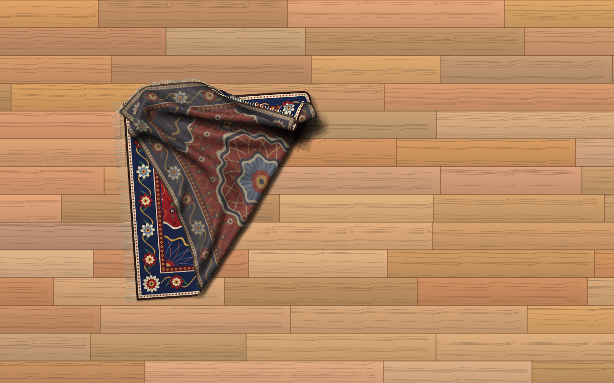 | 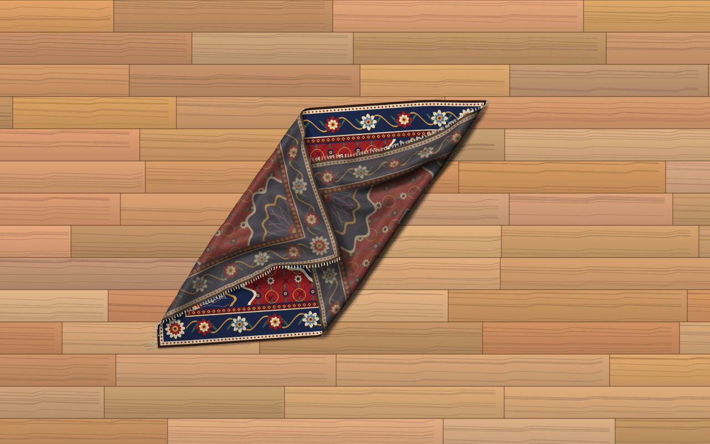 | 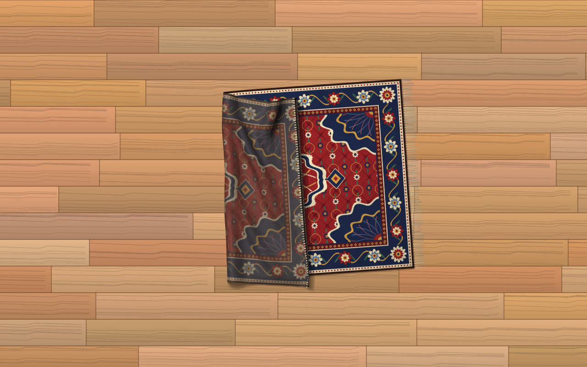 |

---

## English

### What it does
* A Persian rug sits on the desktop, **above the wallpaper/icons and below normal windows**. A tray toggle switches between "desktop layer" and a normal window.
* **The rug is a real-time 3D cloth.** It is a textured mesh of about 62×39 particles (≈2 400) driven by position-based dynamics:
  * Physics: structural, shear and bending constraints, gravity, floor collision, floor and layer friction, damping, and layer separation so folded layers rest on each other with no z-fighting.
  * Tuning makes it feel heavy and stiff, like a thick hand-knotted rug, not a silk scarf.
  * Rendering: OpenGL with normal-based lighting (diffuse plus a subtle sheen), soft drop/contact shadows, a duller woven back side, and swaying fringes (ریشه) on both short ends.
* **Per-pixel click-through.** Only the visible rug takes the mouse. The revealed floor and everything else pass clicks straight to the desktop, so you can drag icons under the fold. The input mask follows the rug's silhouette every rendered frame.
* **Bumps over hidden icons.** The cloth drapes over small bumps where desktop icons are hidden. On Windows, positions come from Explorer's `SysListView32`.
* There is a built-in rug: procedurally generated original artwork (`tools/gen_rug.py`, CC0). You can also load any PNG/JPG with **Change rug image…**.
* Saved state: pose, size and options go to `settings.json` (`~/.config/desktop-rug/` or `%LOCALAPPDATA%\desktop-rug\`). The full cloth shape, including folds, goes to `settings.cloth.json` next to it, and so does the last fold, so a click can re-fold it.
* Tray menu: Show/Hide, Lay flat / lift fold, **Rug design ▸**, **Background ▸**, Keep on desktop layer, Bumps, Compatibility click-through mask, **Start with system**, Reset, About, **Quit**. The same menu opens when you right-click the rug.

### Controls
| Action | Mouse |
|---|---|
| Fold | **Drag any point** of the rug. It lifts the grabbed spot (higher the farther you pull), so you can fold a corner, fold the whole rug over, or fold again on top of a fold. Release and it settles under gravity. Grabbing the middle of an edge holds the whole edge like a bar. |
| Unfold | **Click a folded rug.** It swings back flat smoothly and hides what's under it. |
| Re-fold | Click the spot that was folded before. The last fold swings back. |
| Move | **Middle-drag**, or **Ctrl+drag** inside the rug, or **press and hold** (~0.5 s, without moving) then drag |
| Resize | **Ctrl+drag an edge** (the rug is laid flat first) |
| Rotate | **Shift+drag** (or **Alt+drag**; on Linux most window managers reserve Alt+drag for moving windows, so use Shift there) |
| Menu | Right-click the rug, or use the tray icon |

### Starts with the system, and stays on
* **Autostart is on by default.** The first time you run the packaged app, it copies itself to a stable per-user folder and registers itself to start at login. No admin rights are needed.
  * **Windows:** the app goes to `%LOCALAPPDATA%\DesktopRug\DesktopRug.exe`, and the `HKCU\…\CurrentVersion\Run` value `DesktopRug` is set to `"…\DesktopRug.exe" --autostart`.
  * **Linux:** the app goes to `~/.local/share/desktop-rug/DesktopRug.AppImage`, and an XDG autostart entry `~/.config/autostart/desktop-rug.desktop` is written (`X-GNOME-Autostart-enabled=true`, `QT_QPA_PLATFORM=xcb`, with a short delay). It goes through a small launcher that falls back to extract-and-run when FUSE is missing.
* It keeps working if you move or delete the downloaded file, after reboots and power-offs, and after crashes. **Quitting from the menu does not turn autostart off.** Only the **Disable** file or unticking **Start with system** does. After you disable it, starting the app by hand will not quietly turn autostart back on.
* **At login:**
  * Windows: it waits until Explorer's desktop and taskbar are up.
  * Linux: it waits up to 30 s for the compositor, and keeps retrying the tray icon for a minute.
  * It runs from the install folder.
  * **Single instance:** a second start, manual or automatic, only brings the running rug to the front.
* **One-click files**, shipped next to the binaries and also copied into the install folder:

| | Windows | Linux |
|---|---|---|
| Turn on (install + autostart + start now) | `فعال‌سازی فرش.bat` / `Enable-DesktopRug.bat` | `Desktop Rug - Enable` (.desktop) / `enable-desktop-rug.sh` |
| Turn off (close + remove autostart; settings kept) | `غیرفعال‌سازی فرش.bat` / `Disable-DesktopRug.bat` | `Desktop Rug - Disable` / `disable-desktop-rug.sh` |
| Remove everything (app + settings) | `حذف کامل فرش.bat` / `Uninstall-DesktopRug.bat` | `uninstall-desktop-rug.sh` |

  * The .bat files are plain ASCII with CRLF line endings, and they start with `chcp 65001`, so the Persian file names cause no encoding problems.
  * Each script calls the app's own CLI flags and also does the work directly (`reg add/delete`, `taskkill`, or `rm` + `pkill`), so it works even if one of the two paths fails.
  * On Linux, the Enable/Disable launchers are also added to the application menu.
* CLI flags (they don't open a window): `--enable-autostart`, `--disable-autostart`, `--quit-running` (the running rug saves and exits), `--uninstall`.

### Rug designs and background
* **Rug design** (menu → *Rug design*): four built-in procedurally generated designs, **Tabriz** (red), **Kashan** (navy), **Nain** (ivory & blue) and **Qashqai** (rust & green), or any custom image. Your choice is saved. You can also pass `--design kashan`.
* **Background** (menu → *Background (wallpaper)*): sets the real **desktop wallpaper** to one of four bundled floors (light parquet, dark wood, stone tiles, carpet) or any image. The first time, it remembers your original wallpaper, and **Restore original wallpaper** puts it back. CLI: `--wallpaper stone_tiles|FILE`, `--restore-wallpaper`. Images are first copied to `<config>/desktop-rug/wallpapers/`.

| Desktop | Method | Tested here |
|---|---|---|
| Windows 10/11 | `SystemParametersInfoW(SPI_SETDESKWALLPAPER)`, per user, "Fill" style | under Wine (registry checked) |
| GNOME / Ubuntu / Budgie / Pop | `gsettings org.gnome.desktop.background picture-uri` (+ `-dark`) | ✔ (gsettings + dconf) |
| Cinnamon / MATE | `gsettings org.cinnamon.desktop.background` / `org.mate.background` | not tested |
| Xfce | `xfconf-query -c xfce4-desktop …/last-image` (all monitors/workspaces) | ✔ (xfconf) |
| KDE Plasma | `plasma-apply-wallpaperimage`, else `qdbus … evaluateScript` | not tested |
| LXDE / LXQt | `pcmanfm(-qt) --set-wallpaper` | not tested |
| Other X11 WMs | `feh --bg-fill` | ✔ (root window changed) |

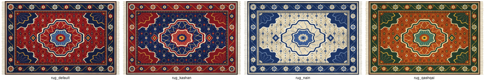
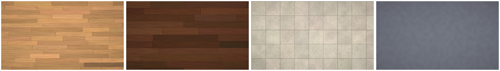
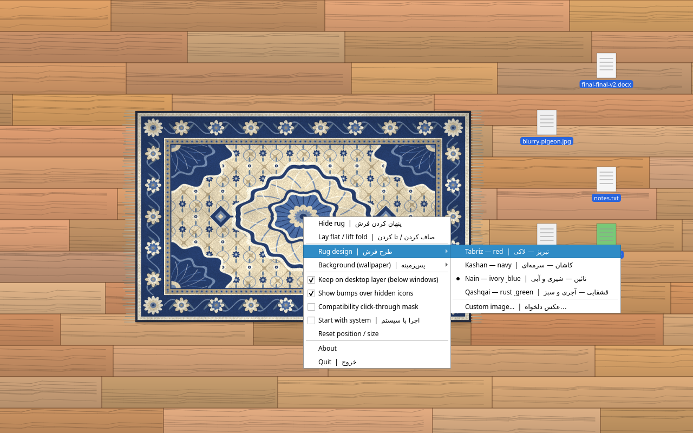

### Download / run
| OS | Artifact | Run |
|---|---|---|
| Release bundles | `release/DesktopRug-Windows.zip`, `release/DesktopRug-Linux.tar.gz` | Unpack, then double-click the **Enable** file (see `README_FA.txt` inside). |
| Linux x86_64 | `dist/linux/DesktopRug-x86_64.AppImage` or `dist/linux/desktop-rug` (single file) | `chmod +x` it, then run it. Needs glibc ≥ 2.38 (Ubuntu 24.04+, Debian 13, Fedora 39+). For older distros, use the CI build (ubuntu-22.04) or run from source. |
| Windows 10 (1809+)/11 x64 | `dist/windows/DesktopRug.exe` (single file, no installer) | Double-click it. SmartScreen may warn because the exe is unsigned: *More info → Run anyway*. |

### Run from source
```bash
# Linux
python3 -m venv .venv && .venv/bin/pip install -r requirements.txt
gcc -O3 -ffast-math -fno-finite-math-only -shared -fPIC -o desktop_rug/native/libclothsim.so desktop_rug/native/clothsim.c -lm   # optional, ~2x faster physics
.venv/bin/python -m desktop_rug          # or ./run_from_source.sh
# Debian/Ubuntu may need: sudo apt install libxcb-cursor0 libxkbcommon-x11-0 libxcb-icccm4 libxcb-keysyms1 libgl1
```
```bat
:: Windows (Python 3.10–3.12 x64 from python.org). desktop_rug\native\clothsim.dll ships prebuilt.
py -3 -m venv .venv
.venv\Scripts\pip install -r requirements-windows.txt
.venv\Scripts\pythonw -m desktop_rug     :: or run_from_source.bat
```
CLI options:
* `--reset`, `--image FILE`, `--settings FILE`, `--folded yes|no`, `--geometry cx,cy,w,h,angle`.
* `--renderer auto|opengl|software`, or the env var `DESKTOP_RUG_RENDERER`.
* `--stats` prints the renderer and FPS.
* `--render-preview out.png --preview-scenario flat|corner|edge|over|double|unfold|bumps` runs the physics off-screen, renders one frame and exits.
* `DESKTOP_RUG_NO_NATIVE=1` forces the pure-numpy solver.

### Build
* **Linux:** `./build_linux.sh` compiles the C solver with gcc, then builds a PyInstaller one-file binary (`dist/linux/desktop-rug`) and an AppImage (`dist/linux/DesktopRug-x86_64.AppImage`).
* **Windows, native:** `build_windows.bat` → `dist\windows\DesktopRug.exe`. It uses the prebuilt `clothsim.dll`; to rebuild that DLL, run `gcc -O3 -shared -static-libgcc -o desktop_rug/native/clothsim.dll desktop_rug/native/clothsim.c` (MinGW).
* **Windows, cross-built on Linux:** `./build_windows_wine.sh`. It builds the DLL with `x86_64-w64-mingw32-gcc`, then runs PyInstaller under Wine with the Windows CPython 3.12 NuGet package. This is how the included exe was built.
* **CI:** `.github/workflows/build.yml` builds the Windows exe (windows-latest) and the Linux binary + AppImage (ubuntu-22.04), compiles the solver, runs unit tests (geometry + cloth physics) and an off-screen render smoke test, and uploads artifacts.
* **Windows pins** (`requirements-windows.txt`):
  * `PySide6-Essentials==6.9.3`. Qt ≥ 6.10 links to the OS `icuuc.dll`, which Windows 10 1903+ has and Wine does not.
  * `numpy==1.26.4`. numpy 2.x wheels call a ucrtbase function Wine 10 doesn't implement.
  * Both work fine on real Windows.
* **Release bundles:** `python3 tools/make_release.py` → `release/DesktopRug-Windows.zip` (exe + Enable/Disable/Uninstall .bat in ASCII and Persian names + `README_FA.txt`) and `release/DesktopRug-Linux.tar.gz` (AppImage + scripts + `.desktop` launchers + `README_FA.txt`).
* Regenerate artwork with `pip install numpy pillow`, then:
  * rugs: `python tools/gen_rug.py --palette tabriz|kashan|nain|qashqai [--seed N]`
  * floors: `python tools/gen_floors.py`
  * app icons: `python tools/make_icons.py`

### How it works (tech)
* **Physics** (`desktop_rug/cloth.py`, with the hot loop in `desktop_rug/native/clothsim.c` loaded through ctypes):
  * Verlet integration, 2 substeps × 9 Gauss-Seidel iterations.
  * The grabbed patch moves rigidly. Long-range tethers stop the rug from stretching, so it slides when you pull it.
  * Positional static/kinetic friction on the floor and between layers keeps it from creeping.
  * A binned height sort pushes overlapping layers one thickness apart.
  * The rug sleeps once it has settled, so it costs no CPU when idle.
  * Unfold/re-fold is a smooth kinematic arc back to the flat (or remembered) shape.
  * Physics costs about 6–7 ms/frame with the C helper and about 14 ms with pure numpy.
* **Rendering** (`render_gl.py`):
  * An offscreen multisampled OpenGL FBO (QOpenGLContext + QOffscreenSurface, GLSL 1.20).
  * Passes: soft shadows from 8 jittered offset passes, then the two-sided cloth (front texture or woven back), then fringe lines.
  * The frame is read back as a premultiplied ARGB image and shown in a translucent frameless window.
  * Going through an ordinary translucent window keeps transparency and click-through working the same way on Windows and X11 as before.
  * If OpenGL can't be created, `render_soft.py` draws the mesh with affine-textured QPainter triangles. It is slower but complete, and the app switches to it automatically.
* **Click-through:**
  * **X11:** the frame's alpha (≥ 50 %) becomes the window's SHAPE *input* region through libXext, updated as the rug moves.
  * **Windows:** layered windows already let clicks pass through transparent pixels.
  * **Fallback:** `QWidget.setMask()` ("Compatibility click-through mask").
* **Desktop layer:**
  * **X11:** `_NET_WM_STATE_BELOW`.
  * **Windows:** `HWND_BOTTOM`, with `WM_WINDOWPOSCHANGING` intercepted and `WS_EX_NOACTIVATE | WS_EX_TOOLWINDOW` set.

### Tested
* **Linux** (Debian 13, Xvfb + xfwm4 compositor, Mesa llvmpipe, i.e. *no GPU*, with the fake desktop `tools/fake_desktop.py` and its draggable icons). The AppImage, the one-file binary and the source build passed `tools/smoke_test_x11.sh`. Screenshots are in `screenshots/linux_appimage/`. Covered:
  * drag-folding the corner all the way over
  * click-through into the revealed area and dragging icons into it
  * click to unfold (icons hidden), click to re-fold
  * folding from an edge and unfolding it
  * Ctrl+edge resize, Shift rotate, middle-drag move
  * Hold-to-move was tested separately.
* **Windows exe under Wine 10** (same X server): passed the same smoke test (`screenshots/wine_exe/`). OpenGL works under Wine, which maps it to the host Mesa. `--renderer software` and the automatic fallback were also tested (`screenshots/previews/wine_exe_double_software.png`, `auto_fallback_software_corner.png`). It has **not been run on real Windows 10/11**.
* **Unit tests:** `python -m unittest discover -s tests` covers fold geometry, cloth physics (settling, no stretching, the flap rests above the rug, unfold animation, serialisation) and the autostart logic.
* **Autostart and Enable/Disable files:**
  * Linux, `tools/test_autostart_linux.sh` (19 checks):
    * the first run installs the copy, writes the XDG entry and the menu launchers
    * a second start does not run twice
    * deleting the download and then `kill -9` keeps autostart
    * a simulated login with `gio launch` on the autostart entry starts the installed copy with `QT_QPA_PLATFORM=xcb`
    * Quit keeps autostart
    * the Enable/Disable `.desktop` launchers and `.sh` scripts work, and Disable kills the process and keeps settings
    * a manual start after Disable does not re-enable
  * Windows exe under Wine, `tools/test_autostart_wine.sh` (16 checks):
    * the first run installs to `%LOCALAPPDATA%\DesktopRug` and sets the HKCU Run value (checked with `wine reg query`)
    * Quit keeps the Run key
    * a simulated login with the Run-key command line works, and a second start exits
    * the Persian-named and ASCII Enable/Disable .bat files work through `wine cmd`, with the process started and killed and the Run key added and removed
    * Disable works from the install folder after the download folder is deleted
* **Wallpaper:**
  * GNOME `gsettings` set and restore (including `picture-uri-dark`), Xfce `xfconf-query` set and restore, and `feh` on a bare X server were tested on this box.
  * Windows `SystemParametersInfoW` was tested under Wine: the registry `Wallpaper` value and the style were set and then restored.
  * Cinnamon, MATE, KDE and LXDE/LXQt are implemented but untested.

### Limitations
* **Frame rate:** about 60 fps is realistic on a real GPU. On this test box (software OpenGL, no GPU) it ran at about **35–40 fps** while moving. The GPU→CPU readback needed for a click-through translucent window is part of the cost, and screen-sized rugs cost more. The software (QPainter) fallback manages only about 5 fps, but it keeps the app usable. When the rug is still, the simulation sleeps and uses ~0 CPU.
* **Not a full cloth solver.** Self-collision is layer separation for a mostly flat rug, not general triangle-triangle collision. Extreme crumpling (dragging in fast circles) can make layers poke through briefly until it settles. Use the menu's *Lay flat* (or a click) to reset.
* **Windows click-through:** the soft shadow's semi-transparent pixels also catch clicks, a few pixels around a folded edge.
* **Wayland:** clients cannot position windows or stay below others. The app forces XWayland (`QT_QPA_PLATFORM=xcb`) when available; on pure Wayland it won't work properly. On GNOME, use "GNOME on Xorg".
* **Desktop layer per DE:** Xfce, MATE, Cinnamon, KDE/X11 and most EWMH WMs honour "below". Tiling WMs may tile the rug, so turn off "Keep on desktop layer" or add a rule. Alt+drag usually belongs to the WM on Linux.
* **Windows:** Win+D hides the rug like any other window. The rug sits at the bottom of the normal z-order, not inside Explorer's WorkerW. Icon-bump detection may fail with an elevated Explorer, and then shows no bumps. It has not been tried on real hardware or mixed-DPI multi-monitor setups.
* **Linux icons:** no bump detection (no standard API). `DESKTOP_RUG_ICONS_FILE=/path` (`x,y;x,y`) lets scripts feed positions in.
* A transparent X11 window needs a running compositor.
* **Autostart:**
  * Turning autostart on by default happens only in the packaged builds. Running from source never registers itself automatically; use `--enable-autostart` for that.
  * It is per user. Other accounts on the same PC are not affected.
  * Windows "Fast startup" or a restart restores it at the next login, not before you log in.
  * Under Wine there is no `timeout.exe`, so the .bat files fall back to `ping` for their short pause.
  * Real Windows 10/11 has not been tested.
* **Linux launchers:** GNOME may ask you to *Allow Launching* the `.desktop` launchers in the downloaded folder. Some file managers ask whether to run or open `.sh` files. After the first run, the Enable/Disable entries are also in the application menu.
* **Wallpaper:**
  * "Restore" can only bring back a wallpaper that was an image file. On Windows a plain colour is restored too; on Linux a plain colour is not.
  * GNOME and KDE may need a moment to redraw.
  * On multi-monitor Xfce, every monitor and workspace gets the same image.

### Credits
Concept: Terkel Gjervig (@terkelg), "made a rug for your desktop so you can sweep your mess under it". This is an independent re-implementation with no code or assets from the original. Rug artwork: procedurally generated, CC0. Code: MIT.

---

<div dir="rtl">

## فارسی

### این برنامه چیست؟
یک فرش ایرانی که روی دسکتاپ شما پهن می‌شود. فایل‌های شلوغ دسکتاپ را زیرش جارو کنید! این نسخه‌ی چندسکویی (ویندوز ۱۰/۱۱ و لینوکس) از ایده‌ی macOS ترکل گیروِیگ ([@terkelg](https://x.com/terkelg)) است.

### امکانات
* فرش در لایه‌ی دسکتاپ می‌نشیند: **روی والپیپر و آیکون‌ها و زیر پنجره‌های معمولی**.
* **فرش یک پارچه‌ی سه‌بعدی واقعی است که در لحظه شبیه‌سازی می‌شود.** یک شبکه‌ی بافت‌دار با حدود ۶۲×۳۹ ذره (نزدیک ۲۴۰۰).
  * فیزیک: قیدهای کششی، برشی و خمشی، گرانش، برخورد با زمین، اصطکاک، میرایی و جداسازی لایه‌ها. لایه‌های تاشده روی هم می‌نشینند و درهم فرو نمی‌روند.
  * طوری تنظیم شده که مثل یک فرش دستباف ضخیم **سنگین و خشک** باشد، نه مثل روسری ابریشمی.
  * رندر: OpenGL با نورپردازی بر پایه‌ی نرمال (پخشی و کمی براقی)، سایه‌ی نرم، پشت فرش کدرتر با بافت تار و پود، و **ریشه**‌هایی که در دو سر کوتاه فرش تکان می‌خورند.
* **عبور کلیک پیکسل‌به‌پیکسل:** فقط بخش دیده‌شده‌ی فرش کلیک را می‌گیرد. ماسک ورودی در هر فریم دنبال شکل فرش می‌رود، پس می‌توانید آیکون‌ها را به زیر تا بکشید.
* فرش روی آیکون‌های پنهان‌شده کمی برآمده می‌شود (در ویندوز).
* فرش پیش‌فرض با کد تولید شده است (CC0). هر عکس PNG یا JPG دیگری را هم می‌توانید بارگذاری کنید.
* موقعیت، اندازه و تنظیمات در `settings.json` ذخیره می‌شوند. شکل کامل پارچه (با تاها) و آخرین تا هم در `settings.cloth.json` ذخیره می‌شوند.
* منوی Tray: نمایش/پنهان، صاف کردن/تا کردن، **طرح فرش**، **پس‌زمینه**، **اجرا با شروع سیستم**، بازنشانی، **خروج**. با کلیک راست روی فرش هم همین منو باز می‌شود.

### کنترل‌ها
| کار | ماوس |
|---|---|
| تا کردن | **هر نقطه‌ای از فرش را بگیرید و بکشید.** آن نقطه بلند می‌شود؛ هرچه دورتر بکشید، بلندتر. می‌توانید یک گوشه را تا کنید، کل فرش را برگردانید یا روی یک تا دوباره تا بزنید. وقتی رها کنید، فرش با گرانش آرام می‌نشیند. اگر وسط یکی از لبه‌ها را بگیرید، کل آن لبه مثل یک میله بلند می‌شود. |
| باز کردن | **روی فرشِ تاشده کلیک کنید.** فرش نرم صاف می‌شود و زیرش را می‌پوشاند. |
| تا کردن دوباره | روی جایی که قبلاً تا شده بود کلیک کنید. |
| جابه‌جایی | **کشیدن با کلید وسط ماوس**، یا **Ctrl + کشیدن** داخل فرش، یا **نگه داشتن** دکمه (حدود نیم ثانیه، بدون حرکت) و بعد کشیدن |
| تغییر اندازه | **Ctrl + کشیدن لبه** |
| چرخاندن | **Shift + کشیدن** (یا Alt + کشیدن؛ در لینوکس معمولاً Alt مال مدیر پنجره است، پس Shift را بزنید) |
| منو | کلیک راست روی فرش یا آیکون Tray |

### اجرای همیشگی با روشن شدن سیستم
* **اجرای خودکار به‌طور پیش‌فرض روشن است.** بار اول که برنامه را اجرا کنید، خودش را در یک پوشه‌ی ثابت کپی می‌کند و به اجرای خودکار اضافه می‌شود. به دسترسی Administrator نیازی نیست.
  * ویندوز: `%LOCALAPPDATA%\DesktopRug` و کلید `Run` در `HKCU`.
  * لینوکس: `~/.local/share/desktop-rug` و `~/.config/autostart/desktop-rug.desktop`.
* بعد از ری‌استارت، خاموش و روشن کردن، کرش برنامه، یا پاک کردن فایل دانلودشده هم اجرا می‌شود. **«خروج» از منو اجرای خودکار را خاموش نمی‌کند.** فقط فایل **غیرفعال‌سازی** یا برداشتن تیک «اجرا با سیستم» آن را خاموش می‌کند.
* برنامه هیچ‌وقت دو بار هم‌زمان اجرا نمی‌شود. بعد از ورود به سیستم هم صبر می‌کند تا دسکتاپ و کامپوزیتور آماده شوند.
* فایل‌های یک‌کلیکی (کنار برنامه و داخل پوشه‌ی نصب):
  * **ویندوز:**
    * «فعال‌سازی فرش.bat» (یا `Enable-DesktopRug.bat`)
    * «غیرفعال‌سازی فرش.bat» (یا `Disable-DesktopRug.bat`)
    * «حذف کامل فرش.bat» (یا `Uninstall-DesktopRug.bat`)
  * **لینوکس:**
    * «Desktop Rug - Enable» و «Desktop Rug - Disable» (در منوی برنامه‌ها هم اضافه می‌شوند)
    * `enable-desktop-rug.sh`، `disable-desktop-rug.sh`، `uninstall-desktop-rug.sh`
* غیرفعال‌سازی فرش را می‌بندد و اجرای خودکار را برمی‌دارد، ولی تنظیمات (جا، اندازه، طرح) می‌ماند.

### طرح فرش و پس‌زمینه
* **طرح فرش** (منو ← «طرح فرش»): چهار طرح آماده‌ی **تبریز** (لاکی)، **کاشان** (سرمه‌ای)، **نائین** (شیری و آبی) و **قشقایی** (آجری و سبز)، یا هر عکس دلخواه. انتخاب شما ذخیره می‌شود.
* **پس‌زمینه** (منو ← «پس‌زمینه»): **والپیپر واقعی دسکتاپ** را عوض می‌کند. چهار کف آماده دارد (پارکت روشن، چوب تیره، کاشی سنگی، موکت) و عکس دلخواه هم می‌شود گذاشت.
  * بار اول، والپیپر قبلی شما ذخیره می‌شود و با «برگرداندن پس‌زمینه‌ی قبلی» برمی‌گردد.
  * پشتیبانی: ویندوز، GNOME، Cinnamon، MATE، Xfce، KDE، LXDE/LXQt و feh.

### دانلود و اجرا
* **بسته‌های آماده:** `release/DesktopRug-Windows.zip` و `release/DesktopRug-Linux.tar.gz`. بسته را باز کنید و روی فایل **فعال‌سازی** دوبار کلیک کنید. راهنمای فارسی `README_FA.txt` داخل هر بسته است.
* **لینوکس:** فایل `dist/linux/DesktopRug-x86_64.AppImage` یا `dist/linux/desktop-rug` را با `chmod +x` اجرایی کنید و اجرا کنید. به glibc نسخه‌ی ۲٫۳۸ یا بالاتر نیاز دارد. برای توزیع‌های قدیمی‌تر از بیلد CI یا اجرا از سورس استفاده کنید.
* **ویندوز ۱۰ (۱۸۰۹ به بعد) و ۱۱:** روی `dist/windows/DesktopRug.exe` دوبار کلیک کنید. فایل امضا ندارد و ممکن است SmartScreen هشدار بدهد؛ «More info» و بعد «Run anyway» را بزنید.

### اجرا از سورس
* لینوکس: `./run_from_source.sh`. برای فیزیک سریع‌تر، `desktop_rug/native/clothsim.c` را با gcc کامپایل کنید (دستورش در بخش انگلیسی است).
* ویندوز: پایتون ۳٫۱۰ تا ۳٫۱۲ (۶۴ بیتی)، بعد `pip install -r requirements-windows.txt` و `pythonw -m desktop_rug`. فایل `clothsim.dll` آماده همراه پروژه است.
* اگر OpenGL در دسترس نباشد، برنامه خودش به رندر نرم‌افزاری می‌رود. برای اجبار: `--renderer software`.

### ساخت (Build)
* لینوکس: `./build_linux.sh` (کامپایل حل‌کننده‌ی C، بعد PyInstaller و AppImage).
* ویندوز روی خود ویندوز: `build_windows.bat`.
* ویندوز روی لینوکس با Wine: `./build_windows_wine.sh`. فایل exe همراه پروژه همین‌طور ساخته شده است.
* GitHub Actions: فایل `.github/workflows/build.yml` هر دو خروجی را می‌سازد و تست می‌کند.

### آزمایش‌شده‌ها
* **لینوکس:** روی Xvfb با کامپوزیتور xfwm4 و OpenGL نرم‌افزاری (بدون GPU). AppImage، فایل تکی و اجرا از سورس هر سه تست خودکار `tools/smoke_test_x11.sh` را گذراندند: تای کامل گوشه، عبور کلیک و کشیدن آیکون به زیر فرش، باز کردن و تای دوباره با کلیک، تا از لبه، تغییر اندازه، چرخش و جابه‌جایی.
* **اجرای خودکار و فایل‌های فعال/غیرفعال‌سازی:**
  * لینوکس: ۱۹ بررسی خودکار، از جمله شبیه‌سازی ورود به سیستم و کرش.
  * ویندوز زیر Wine: ۱۶ بررسی، از جمله فایل‌های bat با نام فارسی و کلید رجیستری.
  * همه قبول شدند.
* **تغییر والپیپر:**
  * روی این سیستم تست شد: GNOME (gsettings)، Xfce (xfconf)، feh، و ویندوز زیر Wine.
  * Cinnamon، MATE، KDE و LXDE/LXQt پیاده‌سازی شده‌اند ولی تست نشده‌اند.
* **فایل exe ویندوز:** زیر Wine 10 همان تست را گذراند. OpenGL زیر Wine کار کرد؛ رندر نرم‌افزاری و جایگزینی خودکار هم تست شدند. **روی ویندوز واقعی اجرا نشده است.**

### محدودیت‌ها
* **سرعت:** روی کارت گرافیک واقعی حدود ۶۰ فریم بر ثانیه انتظار می‌رود. روی سیستم تست (OpenGL نرم‌افزاری) هنگام حرکت حدود ۳۵ تا ۴۰ فریم بود. رندر نرم‌افزاری QPainter کند است (حدود ۵ فریم) ولی برنامه را قابل استفاده نگه می‌دارد. فرشِ ساکن تقریباً هیچ CPU مصرف نمی‌کند.
* برخورد پارچه با خودش به‌صورت جداسازی لایه‌هاست، نه برخورد کامل مثلث‌به‌مثلث. با مچاله کردن خیلی شدید، لایه‌ها ممکن است لحظه‌ای از هم رد شوند. با یک کلیک یا «صاف کردن» درست می‌شود.
* در ویندوز پیکسل‌های نیمه‌شفاف سایه هم کلیک را می‌گیرند (چند پیکسل دور لبه‌ی تا).
* **Wayland** پشتیبانی نمی‌شود (برنامه از XWayland استفاده می‌کند). در گنوم «GNOME on Xorg» را انتخاب کنید.
* با Win+D فرش هم پنهان می‌شود. لینوکس تشخیص برآمدگی آیکون ندارد. در X11 باید یک کامپوزیتور در حال اجرا باشد.
* اجرای خودکار فقط برای همان کاربر است. فقط نسخه‌های آماده (exe و AppImage) آن را خودکار روشن می‌کنند؛ اجرا از سورس این کار را نمی‌کند.
* «برگرداندن پس‌زمینه» فقط والپیپری را برمی‌گرداند که فایل عکس بوده است. در ویندوز رنگ ساده هم برمی‌گردد.
* در گنوم ممکن است برای اجرای فایل‌های .desktop لازم باشد «Allow Launching» را بزنید.

### قدردانی
ایده از ترکل گیروِیگ (@terkelg). این برنامه از صفر نوشته شده و هیچ کد یا تصویری از نسخه‌ی اصلی ندارد. کد با مجوز MIT و طرح فرش با مجوز CC0 منتشر شده است.

</div>
